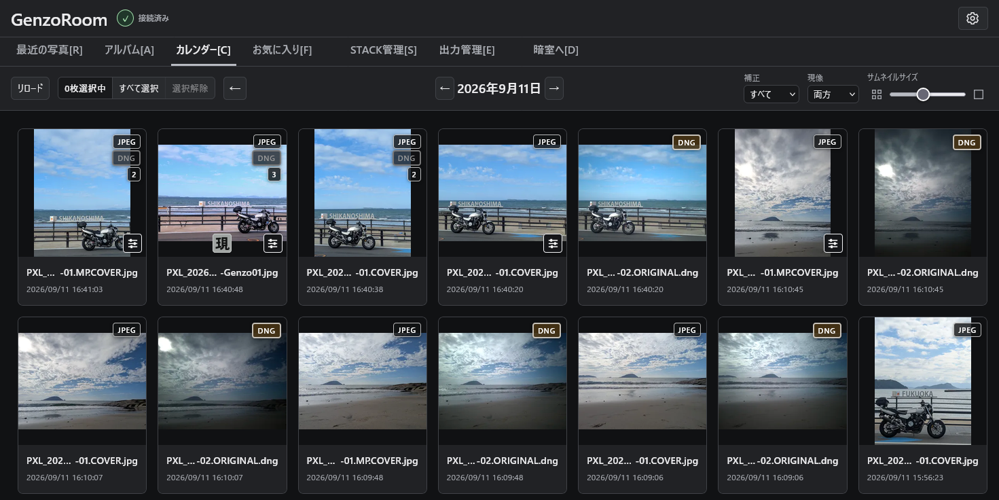
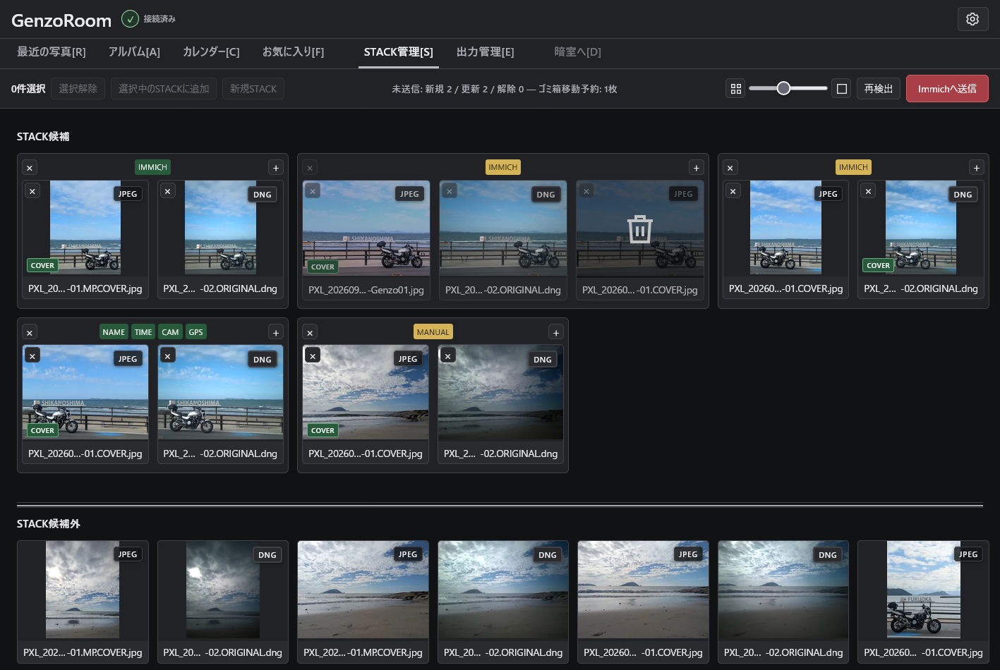
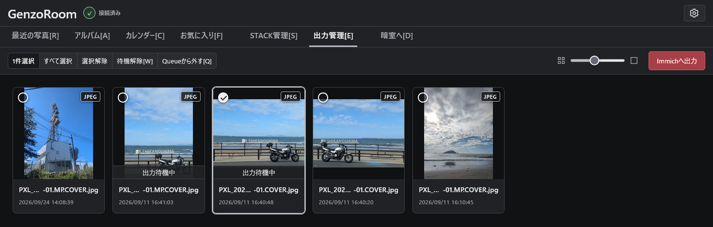

# GenzoRoom

[English](README.md) | 日本語

  
*暗室ワークスペースで編集したJPEGの現像前後の比較。*

GenzoRoom（現像室）は、写真管理アプリ [Immich](https://immich.app/) と連携する、セルフホスト型の写真現像Webアプリです。

Immichでは扱いが難しいJPEGとRAWのペアを自動検出してスタック化するほか、手動でのスタックの組み換えや代表写真（カバー）の変更にも対応しています。

また、JPEG写真の色や明るさを調整する非破壊現像機能を搭載。現像した写真は元画像を残したままImmichに書き戻し、元画像と自動的にスタック化して、新しい写真をカバーに設定します。  
写真の管理はImmichが担当し、GenzoRoomが写真の原本を直接編集・削除することはありません。  
Immichとの連携に特化しているため、外部からの写真の取り込みや、ローカルへのファイル書き出し機能は搭載していません。

ユーザーインターフェースは日本語と英語に対応しています。その他の言語への翻訳協力も歓迎しています。

現在はJPEG現像のみ対応していますが、将来的にはRAW現像への対応も予定しています。

## 現在の機能

### 〇 写真の閲覧と選択 〇

  
*Immich写真の形式やスタック情報を確認できるギャラリー画面。*


ギャラリーでは「最近の写真」「アルバム」「カレンダー」「お気に入り」の各タブから写真を閲覧・選択できます。選んだ写真はSTACK管理や暗室（現像）で使用でき、現像済みの写真は出力管理からImmichへ書き戻せます。  

写真の一覧には、JPEG・RAWなどのファイル形式やスタック内の写真枚数がバッジで表示されます。また、写真の絞り込み、サムネイルサイズの変更、複数の写真の選択にも対応しています。

### 〇 STACK管理 〇

  
*既存STACKの確認、自動候補の検出、手動での組み換え、カバー変更、不要写真のゴミ箱予約に対応したSTACK管理画面。*


RAW+JPEGのペアなどを自動検出してSTACK候補を作成できるほか、手動での組み換えやカバー写真の変更にも対応しています。

自動検出では、ファイル名の最初のドットより前の部分が一致する写真をSTACK候補とします。  
名前が一致しない場合も、撮影日時・カメラ情報・GPS情報（利用可能な場合）を照合して判定します。  
判定の根拠はSTACK上部の「NAME」「TIME」「CAM」「GPS」のバッジで確認できます。

不要な写真はImmichのゴミ箱へ移動予約し、確認後にまとめて送信できます。  

GenzoRoomが元素材ファイルを直接変更・削除することはありません。


### 〇 暗室(現像ワークスペース) 〇

ギャラリーで選択した写真を暗室へ送り、明るさや色合いを調整できます。  
現在はJPEGの現像に対応しており、将来的にはRAW現像への対応も予定しています。

暗室はキーボードショートカットを活用し、マウス操作をできるだけ減らして作業できるよう設計しています。  
複数の写真を送った場合も、フィルムストリップで写真を切り替えながら編集できます。

#### 主な機能

- 高速プレビュー：  
WebGPUによる高速描画に対応。フル解像度とImmichプレビュー画像を切り替えて編集できます。
- 画像比較：  
プレビュー画像とフル解像度のオリジナル画像を切り替えられるほか、編集前後の比較表示にも対応しています。
- 編集レシピのコピー・貼り付け：  
調整した明るさや色などの設定を別の写真にコピーできます。  
すべての調整値をまとめてコピーするほか、必要な項目だけを選んでコピー・貼り付けすることもできます。
- 編集履歴：  
HistoryによるUndo / Redoに対応。不要な中間履歴を整理する圧縮機能を搭載しています。
- 出力予約：  
編集した写真を暗室から出力キューへ追加し、出力管理へ引き渡せます。

編集内容と履歴は自動保存され、元のJPEGを変更することなく、後から再編集できます。

#### ※WebGPUによる高速化について

WebGPUに対応したGPU・ドライバー・ブラウザーを使用することで、編集結果を高速に表示できます。  
対応環境ではフル解像度のオリジナル画像を使ったリアルタイム編集も可能です。

WebGPUを利用するには、以下の条件が必要です。

- WebGPUに対応したGPU・ドライバー・ブラウザー
- HTTPSまたはlocalhostなど、ブラウザーが認めるセキュアコンテキストでの接続
- GenzoRoomの設定でWebGPUを有効化

通常のHTTPによるLAN内アクセスでは、原則としてWebGPUを利用できません。  
ただし、ブラウザーの開発者向け設定で接続先をセキュアコンテキストの例外に登録することで、WebGPUを利用できる場合があります。

WebGPUが利用できない場合もCPUによる編集が可能です。  
処理が重い場合は、Immichが生成したプレビュー画像に切り替えることで負荷を軽減できます。

#### 現在の調整項目

| カテゴリ | 調整項目 |
| --- | --- |
| ホワイトバランス | 色温度(JPEG画像では相対値)、色かぶり補正(TINT)|
| 基本補正 | 露光量、コントラスト、ハイライト、ホワイト、シャドウ、ブラック |
| 色補正 | 自然な彩度、彩度 |
| カラーグレーディング | シャドウ・中間調・ハイライトそれぞれの色温度と色かぶり補正 |

### 〇 出力管理 〇

  

出力素材の予約や出力キューの取り消しを行う出力管理画面。

暗室で編集した写真を出力キューで管理し、出力する写真の選択・待機予約・キューからの取り消しができます。  

出力形式は元画像と同じ解像度の高画質JPEG(sRGB)固定です。  
撮影日時・カメラ・GPSなどのEXIF情報も引き継ぎます。

出力した写真はImmichに新しい素材として登録され、元素材と同じSTACKに追加されます。  
元素材がSTACKに属していない場合は、新しいSTACKを作成します。いずれの場合も、現像した写真がカバーに設定され、元素材はそのまま保持されます。

出力ファイル名には -Genzo01、-Genzo02 のような連番が付与され、Immichの GenzoRoom タグが設定されます。  
ギャラリーでは出力済み写真に「現」バッジが表示されます。

## 現在の制限事項

- **対応画像形式：**  
現在、現像できるのはJPEG画像のみです。RAW(DNGを含む)、HEIC、PNGなどの現像には対応していません。
- **色空間：**  
画像処理は8-bit sRGBで行われます。広色域やHDRでの現像には対応していません。
- **編集内容の保存：**  
編集内容は自動保存されますが、保存完了前にブラウザーを閉じたり再読み込みした場合、直近の変更が失われる可能性があります。
- **ギャラリー：**  
最近の写真は50～500枚の範囲で表示できます。現在、検索機能や追加読み込みには対応していません。
- **モバイル対応：**  
暗室とSTACK管理はデスクトップブラウザー向けに設計されています。STACK管理のタッチ操作によるドラッグ＆ドロップには対応していません。
- **STACK管理：**  
STACKやグループ自体の並べ替えには対応していません。


## 今後の機能候補

現在、以下の機能を将来的な拡張候補として検討しています。

- RAW現像
- クロップ・回転・傾き補正
- ノイズ除去・シャープネス
- マスキング・部分補正
- Waveform Monitor(WFM)、RGB Parade、Vectorscopeなどのスコープ機能

これらは検討段階の機能であり、実装やリリース時期を約束するものではありません。

## セキュリティとデータの取り扱い

GenzoRoomはImmichのAPIを通じて写真にアクセスします。  
ImmichのAPIキーはバックエンド側で管理され、ブラウザーには送信されません。

写真の編集内容や履歴はGenzoRoom側に保存され、Immichの元画像を直接変更することはありません。

STACKの変更や写真のゴミ箱への移動は、ユーザーが確認してImmichへ送信した場合に実行されます。  
ゴミ箱への移動はImmichの通常のゴミ箱機能を使用し、写真を完全削除するものではありません。

ImmichのAPIキーには必要なアクセス権限を設定してください。  
具体的な権限や接続設定については [導入ガイド](docs/deployment.ja.md) を参照してください。

## 必要条件

- Docker Engine / Docker Compose v2
- Linux amd64(x86-64)のDockerホスト。現在、Arm64は動作確認・サポート対象外です。
- GenzoRoomから接続できるImmichサーバー
- 必要なアクセス権限を設定したImmich APIキー
- GenzoRoomにアクセスするためのWebブラウザー。GenzoRoomの標準ポートは 3190 です。

DockerイメージはGitHub Container Registry(GHCR)で公開しています。

詳しい導入方法やImmich APIキーに必要な権限については、[導入ガイド](docs/deployment.ja.md) を参照してください。

## クイックスタート

GenzoRoomは単一のDockerイメージとして配布しています。ソースコードの取得やNode.js、Pythonなどの開発環境は必要ありません。

1. **Immich APIキーの作成**  
GenzoRoom専用のImmich APIキーを作成します。必要なアクセス権限は [導入ガイド](docs/deployment.ja.md) を参照してください。
2. **設定ファイルの準備**  
このリポジトリから[`compose.release.yml`](compose.release.yml)と[`.env.example`](.env.example)を取得し、Immichの接続情報、使用するイメージタグ、データの保存先を設定します。  
保存先ディレクトリには、コンテナが書き込めるよう適切な権限を設定してください。
3. **GenzoRoomの起動**  
設定したディレクトリで、以下のコマンドを実行します。

   ```sh
   docker compose -f compose.release.yml config --quiet
   docker compose -f compose.release.yml pull
   docker compose -f compose.release.yml up -d
   ```

4. **ブラウザーからアクセス**  
ブラウザーで `http://<ホストIP>:3190`  にアクセスします。公開ポートを変更した場合は、そのポートを指定してください。

より詳しい設定方法やImmichとの接続方法は、[導入ガイド](docs/deployment.ja.md)を参照してください。

## アーキテクチャとドキュメント

- **[アーキテクチャ](docs/architecture.md)** — GenzoRoomの技術構成と設計仕様。
- **[導入](docs/deployment.ja.md)** — Docker環境への導入、設定、トラブルシューティング。
- **[開発ノート（日本語）](docs/development-notes.ja.md)** — 開発履歴と設計上の判断。

## 開発について

GenzoRoomは、ChatGPTとOpenAI Codexを活用して開発しているオープンソースプロジェクトです。  
機能の企画・仕様策定・設計方針の決定は開発者が主導し、ChatGPTとの対話を通じて仕様を具体化しています。コードの実装、テストの作成・実行、コード監査にはCodexを活用しています。  
完成した機能は自動テストに加えて実際の環境で動作を確認し、問題点の修正や改善を重ねています。

## ライセンス

GenzoRoomは[GNU Affero General Public License v3.0](LICENSE)（`AGPL-3.0-only`）のもとでライセンスされています。