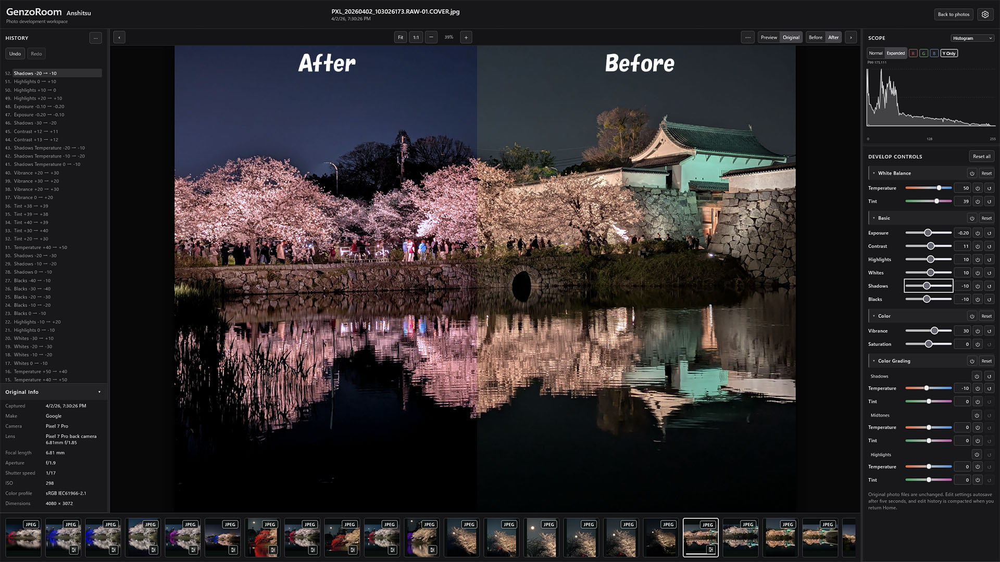
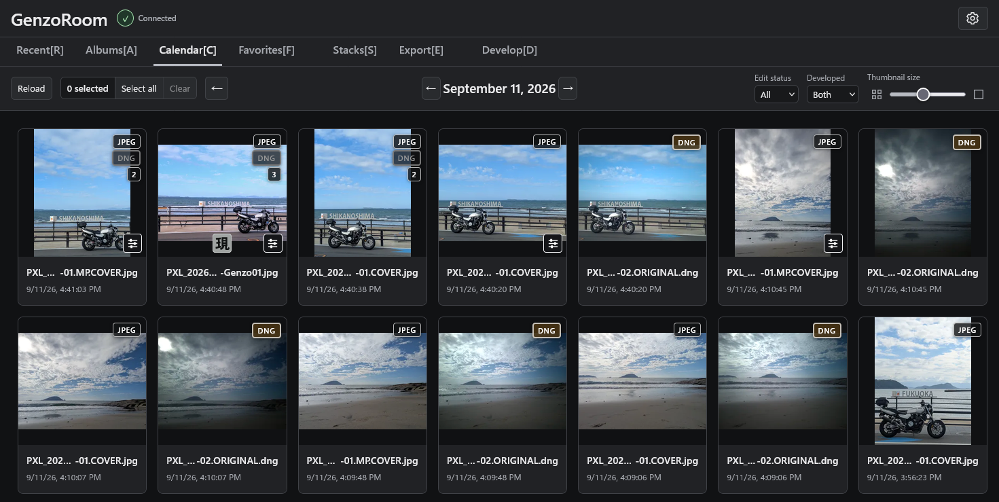
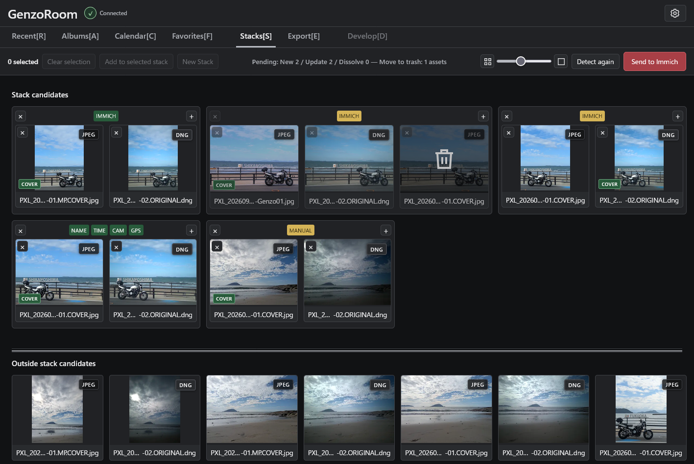
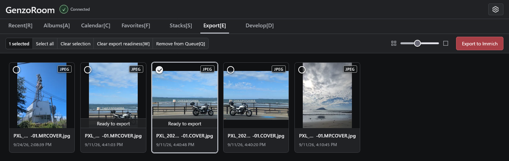

# GenzoRoom

English | [日本語](README.ja.md)

  
*Before and after comparison of a JPEG photo edited in the GenzoRoom Develop workspace.*

GenzoRoom is a self-hosted photo development web application designed to work with [Immich](https://immich.app/).

The name **GenzoRoom** comes from the Japanese word *現像室* (genzōshitsu), meaning "photo developing room." It combines *genzō* (photo development) with the English word "room," and is pronounced "Genzo Room."

It helps manage RAW+JPEG pairs that can be difficult to organize in Immich by automatically detecting stack candidates. You can also manually reorganize stacks and change their cover photos.

GenzoRoom also provides non-destructive JPEG editing for adjusting exposure and color. Developed photos are exported back to Immich without replacing the originals, automatically grouped into stacks with their source photos, and set as the new stack covers.  
Immich remains responsible for managing your photo library. GenzoRoom never directly modifies or deletes your original image files.  
Because GenzoRoom is designed specifically for Immich integration, it does not support importing photos from external sources or exporting files to local storage.

The user interface is available in Japanese and English. Contributions to translate GenzoRoom into other languages are welcome.

JPEG editing is currently supported, with RAW development planned for the future.

## Current Features

### 〇 Photo Browsing and Selection 〇

  
*Gallery view showing photo formats and stack information.*

Browse and select photos from the Recent, Albums, Calendar, and Favorites tabs. Selected photos can be used in Stack Management or Develop, while developed photos can be exported back to Immich through Export Management.

Photo thumbnails display badges indicating file formats such as JPEG and RAW, as well as the number of photos in each stack. The Gallery also supports filtering, adjustable thumbnail sizes, and multiple photo selection.

### 〇 Stack Management 〇

For detailed instructions, see the [Stack Management Guide](docs/guides/stacks.md).

  
*Stack Management workspace showing existing stacks, automatically detected candidates, manual reorganization, cover changes, and photos marked for trash.*

GenzoRoom automatically detects potential stacks, including RAW+JPEG pairs. You can also manually reorganize stacks and change their cover photos.

Automatic detection first looks for photos whose filenames match before the first period.  
When filenames differ, GenzoRoom can also compare capture timestamps, camera information, and GPS data (when available).  
The NAME, TIME, CAM, and GPS badges at the top of each stack indicate the evidence used for matching.

Unwanted photos can be marked for Immich's trash and submitted together with other stack changes after confirmation.

GenzoRoom does not directly modify or delete the original image files.

### 〇 Develop Workspace 〇

Send photos selected in the Gallery to Develop to adjust exposure and color.  
JPEG editing is currently supported, with RAW development planned for the future.

Develop is designed around keyboard shortcuts to minimize mouse interaction.  
When working with multiple photos, you can switch between them using the filmstrip.

#### Main Features

- **Fast preview rendering:**  
  Supports WebGPU acceleration and lets you switch between full-resolution originals and Immich preview images.

- **Image comparison:**  
  Switch between Immich previews and full-resolution originals, and compare images before and after editing.

- **Copy and paste editing recipes:**  
  Copy exposure, color, and other adjustments between photos.  
  You can copy all adjustment values or select only the settings you want to transfer.

- **Edit History:**  
  Supports Undo / Redo and History compression to consolidate intermediate editing steps.

- **Export Queue:**  
  Add edited photos to the Export Queue directly from Develop for later processing in Export Management.

Editing recipes and History are saved automatically, allowing you to return to previous edits without modifying the original JPEG files.

#### WebGPU Acceleration

With a compatible GPU, driver, and browser, WebGPU can accelerate image rendering and editing.  
On supported systems, real-time editing of full-resolution original images is also possible.

WebGPU requires:

- A WebGPU-compatible GPU, driver, and browser
- A secure context, such as HTTPS or localhost
- WebGPU enabled in GenzoRoom's settings

WebGPU is generally unavailable when accessing GenzoRoom over plain HTTP on a local network.  
However, some browsers allow you to register the application URL as a secure-context exception through developer settings.

Editing is still possible using CPU processing when WebGPU is unavailable.  
For better performance with demanding images, you can switch to the lower-resolution preview images generated by Immich.

#### Current Adjustments

| Category | Adjustments |
| --- | --- |
| White Balance | Temperature (relative adjustment for JPEG images), Tint |
| Basic | Exposure, Contrast, Highlights, Whites, Shadows, Blacks |
| Color | Vibrance, Saturation |
| Color Grading | Separate Temperature and Tint adjustments for Shadows, Midtones, and Highlights |

### 〇 Export Management 〇



*Export Management workspace for preparing photos for export and removing items from the Export Queue.*

Manage photos edited in Develop through the Export Queue. You can select photos, mark them as ready for export, or remove them from the queue.

Output is fixed to high-quality sRGB JPEG at the same resolution as the source image.  
Supported EXIF metadata, including capture date and time, camera information, and GPS data, is preserved.

Exported photos are registered in Immich as new assets and added to the same stack as their source photos.  
If a source photo is not already part of a stack, GenzoRoom creates a new one. In both cases, the developed image becomes the stack cover, while the original remains unchanged.

Exported filenames receive sequential suffixes such as `-Genzo01` and `-Genzo02`, and the `GenzoRoom` tag is applied in Immich.  
In the Gallery, exported photos are identified by a 「現」 badge.

## Current Limitations

- **Supported image formats:**  
  Only JPEG images can currently be developed. RAW (including DNG), HEIC, PNG, and other formats are not supported for editing.

- **Color space:**  
  Image processing uses 8-bit sRGB. Wide-gamut and HDR development are not supported.

- **Saving edits:**  
  Edits are saved automatically, but recent changes may be lost if the browser is closed or reloaded before saving finishes.

- **Gallery:**  
  The Recent tab can display between 50 and 500 photos. Search and additional pagination are not currently available.

- **Mobile support:**  
  Develop and Stack Management are designed primarily for desktop browsers. Touch-based drag-and-drop is not supported in Stack Management.

- **Stack Management:**  
  Reordering entire stacks or stack groups is not currently supported.

## Features Under Consideration

The following features are being considered for future development:

- RAW development
- Cropping, rotation, and straightening
- Noise reduction and sharpening
- Masking and selective adjustments
- Additional scopes, including Waveform Monitor (WFM), RGB Parade, and Vectorscope

These are potential future features, not confirmed commitments or a fixed release roadmap.

## Security and Data Handling

GenzoRoom accesses photos through the Immich API.  
The Immich API key is managed by the backend and is never sent to the browser.

Editing recipes and History are stored by GenzoRoom without directly modifying the original images in Immich.

Stack changes and moving photos to Immich's trash are performed only after the user confirms and submits those operations.  
Photos moved to the trash use Immich's normal trash functionality and are not permanently deleted by GenzoRoom.

The Immich API key must have the required permissions.  
See the [Deployment Guide](docs/deployment.md) for the necessary permissions and connection settings.

## Requirements

- A Docker environment supporting Docker Compose v2
- A Linux `amd64` (x86-64) Docker host. Arm64 is not currently verified or supported.
- An existing Immich server accessible from GenzoRoom
- An Immich API key with the required permissions
- A web browser to access GenzoRoom. The default port is `3190`.

Docker images are published through GitHub Container Registry (GHCR).

For detailed setup instructions and required Immich API permissions, see the [Deployment Guide](docs/deployment.md).

## Quick Start

GenzoRoom is distributed as a single Docker image. No source checkout, Node.js, Python, or other development environment is required.

1. **Create an Immich API key**  
   Create a dedicated Immich API key for GenzoRoom. See the [Deployment Guide](docs/deployment.md) for the required permissions.

2. **Prepare the configuration**  
   Download [`compose.release.yml`](compose.release.yml) and [`.env.example`](.env.example) from this repository, then configure your Immich connection, image tag, and persistent data directory.  
   Make sure the container has the necessary write permissions for the data directory.

3. **Start GenzoRoom**  
   Run the following commands from the directory containing your configuration files.

   ```sh
   docker compose -f compose.release.yml config --quiet
   docker compose -f compose.release.yml pull
   docker compose -f compose.release.yml up -d
   ```

4. **Open GenzoRoom in your browser**  
   Navigate to `http://<host-ip>:3190`. If you changed the published port, use that port instead.

For additional configuration options and Immich connectivity details, see the [Deployment Guide](docs/deployment.md).

## Architecture and Documentation

- **[Architecture](docs/architecture.md)** — Technical architecture and design specifications.
- **[Deployment](docs/deployment.md)** — Docker installation, configuration, and troubleshooting.
- **[Development Notes (Japanese)](docs/development-notes.ja.md)** — Development history and design decisions.

## About Development

GenzoRoom is an open-source project developed with the assistance of ChatGPT and OpenAI Codex.  
The developer leads feature planning, requirements, and architectural decisions, using discussions with ChatGPT to refine specifications. Codex is used for code implementation, test creation and execution, and code audits.  
Completed features undergo automated testing and verification in a real deployment environment, followed by iterative fixes and improvements.

## License

GenzoRoom is licensed under the [GNU Affero General Public License v3.0](LICENSE) (`AGPL-3.0-only`).