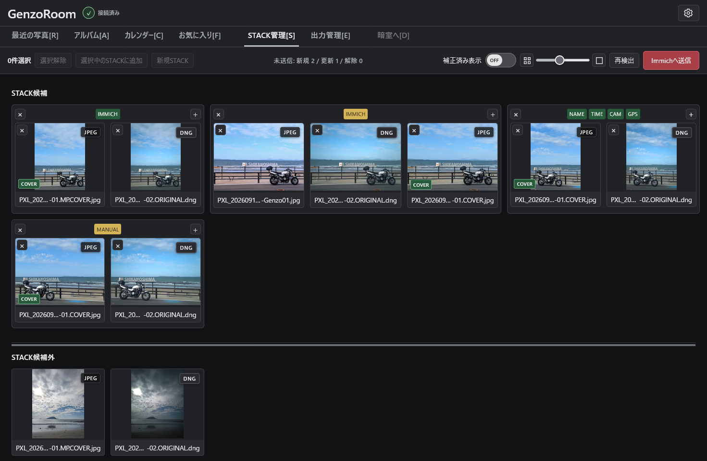
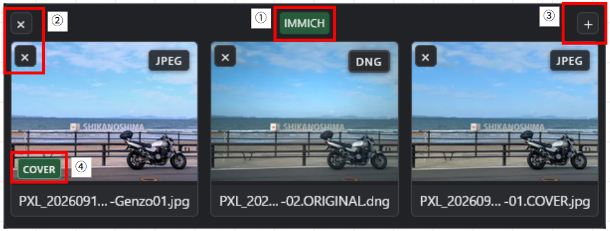

# STACK管理

[English](stacks.md) | 日本語

STACK管理画面では、STACKへの写真の追加や解除、代表写真(COVER)の変更、不要な写真のImmichゴミ箱への移動ができます。

ギャラリーで選択した写真をSTACK管理へ送ると、写真の情報をもとに自動的にSTACK候補がまとめられます。

Immichにすでに登録されているSTACKには「IMMICH」バッジが表示され、STACKに属していない写真は「STACK外候補」に表示されます。これらの写真を使って、手動で新しいSTACKを作成することもできます。

## STACKカードの表示・操作説明

### 1 STACK状態バッジ
STACKの状態や、自動判定に使われた一致情報を表示します。  
| バッジ | 説明 |
| --- | --- |
| **IMMICH (緑)** | Immichに登録されている既存のSTACKです。 |
| **IMMICH (黄)** | Immichの既存STACKに変更が加えられ、送信待ちになっている状態です。 |
| **NAME** | 写真のファイル名が一致したSTACK候補です。 |
| **TIME** | 撮影日時の情報が一致しています。 |
| **CAM** | カメラ情報が一致しています。 |
| **GPS** | 撮影位置情報が一致しています。 |
| **MANUAL** | 手動で作成されたSTACKです。 |

※「CAM」「TIME」「GPS」各バッジは判定状態によって色が変わります。

---
### 2 STACKグループ解除・写真解除ボタン
グループカード左上の 「X」 ボタンをクリックすると、そのSTACK全体を解除します。   
写真カード左上の 「X」 ボタンをクリックすると、その写真だけをSTACKから外します。  
写真2枚のみのSTACKで写真を解除すると、自動的にSTACK全体が解除されます。

---
### 3 追加ボタン
右上の 「＋」 ボタンは、既存のSTACKに写真を追加するときに使用します。  

---
### 4 カバー写真表示バッジ
COVER バッジは、そのSTACKの代表写真に表示されます。  
STACK内の別の写真カードをクリックすると、代表写真(COVER)を切り替えられます。

---
### 5 Immichゴミ箱予約
STACK内写真を右クリックすると「ゴミ箱に入れる」のメニューが出ます。  
これはスタック内で不要になった写真をImmichのゴミ箱に移動させる機能です。  
GenzoRoomでは元写真を消去することなく、Immichのごみ箱に移動するのみです。  
予約のみで「Immichへ送信」ボタンを押すまでは実行されません。

## STACK候補外エリア
自動判定でSTACKグループに分類されなかった写真が表示されます。  
写真を複数選択して「新規STACK」ボタンを押すと、新しいSTACKを作成できます。  
既存STACKに写真を追加する方法は2通りあります。
- 写真を選択し、追加先STACKの右上にある「＋」ボタンを押す。
- 追加先STACKの「＋」ボタンを先に押し、候補外の写真を選択して「選択中のSTACKに追加」ボタンを押す。  

## ドラッグ＆ドロップ操作

写真のドラッグ＆ドロップでも、STACKの作成・編集ができます。

- 写真を既存のSTACKにドロップすると、そのSTACKに追加できます。
- STACK内の写真をSTACK候補外エリアへドロップすると、その写真をSTACKから解除できます。
- STACK候補外の写真同士をドラッグ＆ドロップすると、新しいSTACKを作成できます。

## 再検出・Immichへ送信ボタン

「再検出」ボタンはSTACK管理画面内の写真のSTACK情報を再検出します。  
それまでの操作はすべてリセットされます。

「Immichへ送信」ボタンは、スタック操作を確定させImmichのSTACK組み換えを実行します。

STACKの追加・解除・COVER変更などの編集操作は、Ctrl+Zで直前の1操作をUndoできます。

## 「補正済み表示」切り替えボタン

このスイッチは、STACK管理タブ内でのサムネイル表示を切り替えます

 - OFF - サムネイルはImmichオリジナルをそのまま表示します
 - ON - GenzoRoomで保存された編集レシピを適用したサムネイルを表示します。

初期設定はOFFになっていますので、現像後の写真を確認したい場合はONに切り替えてください

## 没入プレビュー
STACK内の写真をダブルクリックすると全画面表示の没入プレビューができます。  
STACK内の写真のみ左右矢印キー(← / →)や画面左右のクリックで移動できます。  
没入プレビューを解除するときは「Esc」または「V」キーを押してください。

STACK外候補の写真も没入プレビュー可能です。  
同じくダブルクリックをするか、写真を選択し「V」キーを押してください。

---

[← READMEに戻る](../../README.ja.md)