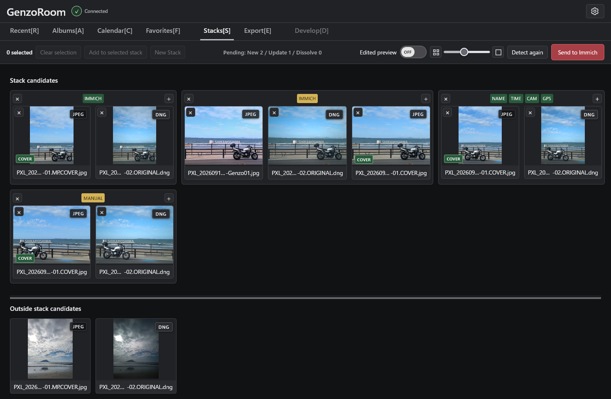

# Stack Management

English | [日本語](stacks.ja.md)

The Stack Management screen lets you add or remove photos from stacks, change the representative photo (COVER), and move unwanted photos to Immich's Trash.

When photos are sent from the Gallery to Stack Management, GenzoRoom automatically groups potential stack candidates based on their metadata.

Stacks that already exist in Immich are marked with an **IMMICH** badge. Photos that do not belong to a stack appear in the **Outside Stack Candidates** area, where you can also select photos to create new stacks manually.

## Stack Card Display and Controls

### 1 Stack Status Badges

These badges indicate the stack's status and the matching information used for automatic detection.

| Badge | Description |
| --- | --- |
| **IMMICH (Green)** | An existing stack registered in Immich. |
| **IMMICH (Yellow)** | An existing Immich stack with pending changes that have not yet been submitted. |
| **NAME** | A stack candidate identified by matching photo filenames. |
| **TIME** | Indicates matching capture date and time information. |
| **CAM** | Indicates matching camera information. |
| **GPS** | Indicates matching location data. |
| **MANUAL** | A stack created manually. |

The colors of the **CAM**, **TIME**, and **GPS** badges vary depending on their matching status.

---

### 2 Remove Stack / Remove Photo Buttons

Click the **X** button in the upper-left corner of a stack group card to dissolve the entire stack.

Click the **X** button in the upper-left corner of an individual photo card to remove only that photo from the stack.

If a photo is removed from a stack containing only two photos, the entire stack is automatically dissolved.

---

### 3 Add Button

Use the **+** button in the upper-right corner of a stack card to add photos to an existing stack.

---

### 4 Cover Photo Badge

The **COVER** badge identifies the representative photo of a stack.

Click another photo card within the stack to make it the new cover photo.

---

### 5 Immich Trash Reservation

Right-click a photo inside a stack to open a menu containing **Move to Trash**.

This feature lets you move unwanted photos from a stack to Immich's Trash without permanently deleting the original files.

The action is only queued at this stage. It is not executed until you click **Submit to Immich**.

## Outside Stack Candidates

This area displays photos that were not grouped into stacks by automatic detection.

Select multiple photos and click **New Stack** to create a new stack.

There are two ways to add photos to an existing stack:

- Select the photos first, then click the **+** button in the upper-right corner of the destination stack.
- Click the **+** button on the destination stack first, select the photos from the Outside Stack Candidates area, then click **Add to Selected Stack**.

## Drag and Drop

You can also create and edit stacks using drag-and-drop operations.

- Drop a photo onto an existing stack to add it to that stack.
- Drag a photo from a stack into the Outside Stack Candidates area to remove it from the stack.
- Drag and drop one unstacked photo onto another to create a new stack.

## Re-detect and Submit to Immich

Click **Re-detect** to refresh the stack detection results for photos in Stack Management.

This resets all changes made in the current Stack Management session.

Click **Submit to Immich** to confirm your stack changes and apply the stack reorganization in Immich.

Stack editing operations, such as adding or removing photos and changing the cover photo, support one-step Undo using **Ctrl+Z**.

## Edited Preview Toggle

This toggle controls how thumbnails are displayed in Stack Management.

- **OFF** — Displays the original thumbnails from Immich.
- **ON** — Displays thumbnails with the editing recipes saved in GenzoRoom applied.

The default setting is OFF. Switch it ON to preview photos with their saved adjustments.

## Immersive Preview

Double-click a photo inside a stack to open it in the full-screen immersive preview.

You can navigate between photos within that stack using the **Left / Right Arrow** keys (← / →) or by clicking the left or right side of the screen.

Press **Esc** or **V** to close the immersive preview.

Photos in the Outside Stack Candidates area can also be opened in immersive preview. Double-click a photo, or select it and press **V**.

---

[← Back to README](../../README.md)